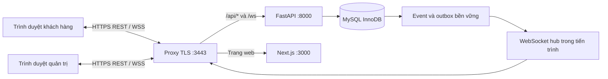

# RealtimeOrders — Hệ thống đặt và điều phối bán hàng thời gian thực

Đồ án môn **Lập trình mạng**, Nhóm **17** · Giảng viên: **Ngô Văn Quyền**.

RealtimeOrders là ứng dụng web client–server giúp khách hàng xem menu theo ngày, đặt nhiều mặt hàng và theo dõi đơn; người bán quản lý sản phẩm, tồn kho, đơn và giao hàng. Backend là nơi quyết định quyền, giá, phí và trạng thái. **Đơn đang chờ không giữ hàng; chỉ khi quản trị duyệt, server mới trừ tồn.**

## Bài toán và mục tiêu

Khi nhiều khách đặt hàng cùng lúc, xử lý thủ công dễ gây bán vượt tồn, nhầm giá giữa các nhóm và chậm cập nhật trạng thái. Dự án tập trung giải quyết ba vấn đề có thể kiểm tra trong mô hình client–server:

- Giữ tồn kho đúng khi nhiều đơn cạnh tranh một lượng hàng hữu hạn.
- Phát thay đổi về đơn hàng và danh mục tới đúng người dùng theo thời gian thực.
- Đồng bộ lại client sau khi tải lại trang hoặc mất kết nối.

Phạm vi là ứng dụng hỗ trợ một người bán, gồm hai vai trò chính: khách hàng và quản trị. Hệ thống chưa có thanh toán trực tuyến, kết nối đơn vị vận chuyển, đổi trả sau khi giao thành công hoặc nhiều máy chủ ứng dụng.

## Thành viên

| Họ tên | MSSV |
| --- | --- |
| Nguyễn Đức Hưng | B23DCCN368 |
| Đỗ Quang Thiệp | B23DCCN787 |
| Vũ Đức Mạnh | B23DCCN535 |
| Lê Nguyễn Hồng Quân | B23DCCN675 |
| Trịnh Văn Hào | B23DCCN284 |

Phân công chi tiết được trình bày trong báo cáo của nhóm.

## Chức năng

**Khách hàng**

- Đăng ký bằng số điện thoại và OTP; email là tùy chọn. Môi trường demo có thể trả mã thử để kiểm tra luồng.
- Xem menu đang mở theo nhóm khách hàng; tìm/lọc mặt hàng, xem đơn vị, giá và lượng còn.
- Thêm món vào giỏ, chọn địa chỉ/cách nhận hàng, xem tổng tiền và gửi đơn.
- Theo dõi trạng thái đơn, thông báo, hội thoại riêng và mặt hàng quan tâm.
- Hủy đơn đang chờ; gửi yêu cầu hủy đơn đã duyệt hoặc đang chuẩn bị để quản trị quyết định.

**Quản trị**

- Quản lý danh mục, đơn vị, SKU tự cấp, ảnh sản phẩm, giá và nhóm được phép mua.
- Tạo menu theo ngày với nhiều sản phẩm; có thể mở nhiều đợt trong ngày và cấu hình thời gian đóng.
- Quản lý chính sách giao, nhóm khách hàng, tài khoản, đơn, hội thoại, kiểm duyệt và báo cáo.
- Duyệt, từ chối, chuẩn bị, bàn giao và xác nhận giao đơn. Đơn đã duyệt chỉ hoàn kho khi quản trị chấp thuận yêu cầu hủy.

**Tính năng cần cấu hình dịch vụ ngoài**

- Tính phí giao riêng theo tuyến đường cần `GOONG_API_KEY` trên server và vị trí kho đã xác nhận. Khi thiếu key hoặc không tìm được tuyến, hệ thống không dùng khoảng cách ước lượng.
- Gửi OTP Zalo/SMS và email thật cần thông tin nhà cung cấp hợp lệ. Cấu hình mẫu bật chế độ demo; chưa có cấu hình không đồng nghĩa với đã kiểm chứng gửi tin thật.
- Chức năng yêu cầu hàng/báo giá đã được gỡ khỏi phạm vi; API cũ trả HTTP 410.

## Kiến trúc



- **Client:** trình duyệt chạy giao diện Next.js; khách và quản trị dùng chung ứng dụng nhưng có quyền khác nhau.
- **Proxy:** Node.js kết thúc TLS tại cổng 3443; chuyển `/api/*` và `/ws` đến backend, các yêu cầu trang đến Next.js.
- **Backend:** FastAPI/Python xử lý xác thực, phân quyền và nghiệp vụ. Trình duyệt không kết nối MySQL trực tiếp.
- **Database:** MySQL/InnoDB là nguồn dữ liệu chính; Alembic quản lý schema. Ảnh tải lên nằm trong thư mục riêng trên server.
- **Realtime:** backend lưu sự kiện/outbox cùng giao dịch nghiệp vụ; sau commit, hub phát theo topic tới các kết nối có quyền.

Cấu hình mặc định chỉ nghe trên máy cục bộ: mở `https://localhost:3443`; backend và frontend nội bộ lần lượt ở cổng 8000 và 3000; MySQL mặc định ở `127.0.0.1:3306`. Có hướng dẫn tùy chọn cho LAN tại [docs/LAN.md](docs/LAN.md), nhưng cần nghiệm thu bằng thiết bị thứ hai trước khi khẳng định đã chạy LAN. Không mở MySQL, cổng 8000 hoặc 3000 cho máy khách.

## Giao tiếp mạng và giao thức

Ứng dụng dùng **HTTPS/REST và WebSocket bảo mật (WSS), đều truyền qua TCP/TLS**. TLS và framing WebSocket do Node.js, Uvicorn và thư viện giao thức xử lý; dự án không tự định nghĩa framing TCP thô. Giao thức ứng dụng được mô tả trong [docs/PROTOCOL.md](docs/PROTOCOL.md), còn các route hiện hành có trong [docs/openapi.json](docs/openapi.json) và `/api/docs` khi server chạy.

- REST dùng prefix `/api/v1` và JSON cho đăng nhập, menu, địa chỉ, báo phí, đơn và thao tác quản trị. Health check là `/api/health`.
- WebSocket dùng `/ws` và thông điệp JSON phiên bản `v: 1`. Client xác thực qua cookie phiên và `Origin`, gửi `HELLO`; server trả `WELCOME` rồi đồng bộ bằng replay hoặc snapshot (`SYNC_BEGIN`, `SNAPSHOT_CHUNK`, `SYNC_END`).
- Sau đồng bộ, hai phía trao đổi `PING`/`PONG`, `CHAT_SEND`, `ACK`, `ERROR` và sự kiện gồm `topic`, `seq`, `eventId`, `eventType`, `payload`.
- Thứ tự được giữ trong từng topic. Client có model/cursor hợp lệ được phát lại sự kiện còn thiếu; khi cursor không còn dùng được, server gửi snapshot. Client mất đồng bộ hoặc nhận quá chậm phải đồng bộ lại hoặc kết nối lại.
- REST trả mã lỗi và thông điệp; WebSocket gửi `ERROR` hoặc đóng kết nối khi phiên, quyền, dữ liệu đầu vào hay giới hạn kết nối không hợp lệ. Retry một thao tác phải giữ nguyên khóa idempotency để tránh tạo đơn hoặc trừ kho trùng.

Luồng cập nhật realtime: client gửi yêu cầu → backend xác thực và kiểm tra nghiệp vụ → MySQL commit thay đổi cùng event/outbox → dispatcher phát sau commit → client trong topic áp dụng event theo `seq`. Khi duyệt đơn, server khóa và kiểm tra các dòng hàng trong transaction; nếu một dòng thiếu tồn thì rollback toàn bộ. Nếu đủ, server cập nhật tồn, ledger, lịch sử, idempotency và event trong cùng transaction.

## Đóng góp kỹ thuật và baseline

1. **Giao dịch tồn kho:** duyệt đơn khóa/kiểm tra toàn bộ dòng hàng, ghi tồn, ledger và trạng thái trong cùng transaction; retry dùng idempotency.
2. **Phát thay đổi:** lưu event/outbox rồi gửi WSS theo topic/seq sau commit; baseline trong phép đo là client polling định kỳ.
3. **Phục hồi:** client có thể replay các sự kiện còn thiếu hoặc nhận snapshot khi cursor không dùng được.

Đây là đóng góp tích hợp và triển khai trong phạm vi đồ án, không tuyên bố thuật toán mới.

## Đồng thời và tính đúng đắn

FastAPI xử lý nhiều yêu cầu bất đồng bộ. Mỗi WebSocket có hàng đợi riêng, giới hạn kích thước để client chậm không chặn toàn bộ kết nối. Hiện ứng dụng chạy **một FastAPI worker**, vì danh sách socket đang hoạt động nằm trong bộ nhớ của tiến trình. Chạy nhiều worker cần event bus dùng chung và kiểm thử liên tiến trình.

Tính nhất quán nghiệp vụ dựa trên transaction/khóa MySQL InnoDB thay vì khóa trong bộ nhớ Python. Duyệt đơn dùng version và idempotency để chống xử lý lặp; ledger ghi biến động tồn. Luồng đồng bộ dùng `seq`, snapshot/replay và outbox để client bắt kịp sau reconnect. Đây là cách triển khai của nhóm, không tuyên bố thuật toán mới.

## Công nghệ

| Thành phần | Công nghệ |
| --- | --- |
| Giao diện | Next.js, React, TypeScript, Tailwind CSS |
| Backend và API | Python 3.12, FastAPI, SQLAlchemy asyncio, Uvicorn |
| Cơ sở dữ liệu | MySQL 8 / InnoDB, asyncmy, Alembic |
| Giao tiếp thời gian thực | WebSocket/WSS, JSON protocol v1 |
| Proxy và TLS | Node.js HTTPS proxy |
| Kiểm thử giao diện | Playwright, Microsoft Edge |
| Ảnh | Pillow và thư mục media riêng trên server |

Dependency backend được khóa trong [backend/requirements.txt](backend/requirements.txt); dependency giao diện nằm trong [frontend/package-lock.json](frontend/package-lock.json).

## Cài đặt và chạy trên Windows

### Yêu cầu

- Windows 10/11.
- Python 3.12.
- Node.js tương thích Next.js 16 (khuyến nghị Node.js 24 LTS) và npm.
- MySQL Server 8.0 trở lên đang chạy tại `127.0.0.1:3306`; tài khoản quản trị có quyền tạo database và user ứng dụng.

### Cài lần đầu

```powershell
git clone https://github.com/theycallmeheng/RealtimeOrders.git
cd RealtimeOrders
powershell -NoProfile -ExecutionPolicy Bypass -File scripts\setup.ps1
```

Script cài dependency, tạo database `realtimeorders` và user riêng nếu chưa có `.env`, chạy migration đến Alembic `head`, seed dữ liệu mẫu khi database chưa có tài khoản, tạo chứng thư thử cho localhost và build giao diện. Script hỏi mật khẩu quản trị MySQL trong terminal; không thay mật khẩu root và từ chối ghi đè database đã tồn tại. Nếu đã có `.env` hoặc database cũ, đọc [docs/OPERATIONS.md](docs/OPERATIONS.md) trước khi chạy setup.

### Khởi động server

```powershell
powershell -NoProfile -ExecutionPolicy Bypass -File scripts\services.ps1 start
```

### Chạy client

Mở `https://localhost:3443`. Chứng thư localhost là chứng thư thử nghiệm; trình duyệt có thể hiện cảnh báo nếu chưa tin cậy chứng thư. Tài khoản demo được sinh ngẫu nhiên, lưu tại `runtime/demo-accounts.local.json` khi seed trên database trống. Nếu database đã có tài khoản, seed không tạo lại hoặc đổi mật khẩu.

```powershell
powershell -NoProfile -ExecutionPolicy Bypass -File scripts\services.ps1 stop-app
```

`stop-app` dừng các dịch vụ ứng dụng nhưng không dừng dịch vụ MySQL có sẵn của Windows. Xem thêm [hướng dẫn vận hành](docs/OPERATIONS.md).

### Cấu hình dịch vụ ngoài

Dùng [.env.example](.env.example) làm danh sách biến; lưu giá trị cục bộ trong `.env` ở thư mục gốc. Không commit tệp này hoặc đưa bí mật vào log/chat.

- Demo: `DEMO_MODE=true`, `SMS_PROVIDER=demo`, `EMAIL_PROVIDER=demo`; mã thử được đánh dấu là demo.
- OTP Zalo: `ZALO_ACCESS_TOKEN`, `ZALO_OTP_TEMPLATE_ID`, `ZALO_OTP_CODE_FIELD`; cần OA/ZBS, quyền gửi và template được duyệt.
- SMS: `SMS_PROVIDER=twilio` cùng `TWILIO_ACCOUNT_SID`, `TWILIO_AUTH_TOKEN`, `TWILIO_FROM`.
- Email: `EMAIL_PROVIDER=smtp` cùng cấu hình SMTP.
- Bản đồ: `GOONG_API_KEY`; chỉ đặt key trên server và xác nhận vị trí kho trong cấu hình quản trị.

Các key là tùy chọn cho demo cục bộ. Tích hợp tương ứng chỉ được xác minh trực tiếp sau khi có cấu hình hợp lệ và chạy thử với nhà cung cấp.

## Kiểm thử và thực nghiệm

Ca kiểm thử, điều kiện chạy và ma trận đo nằm trong [docs/TEST_PLAN.md](docs/TEST_PLAN.md); đối chiếu yêu cầu với thiết kế/test nằm trong [docs/TRACEABILITY.md](docs/TRACEABILITY.md). Test nghiệp vụ cần database MySQL audit riêng; không chạy trên database có dữ liệu thật.

Quy trình cô lập mẫu trên Windows; cần chuẩn bị thông tin quản trị MySQL theo [docs/OPERATIONS.md](docs/OPERATIONS.md):

```powershell
.\.venv\Scripts\python.exe scripts\isolated_validation.py prepare
.\.venv\Scripts\python.exe scripts\isolated_validation.py backend
.\.venv\Scripts\python.exe scripts\isolated_validation.py browser
.\.venv\Scripts\python.exe scripts\isolated_validation.py finish
```

`backend` chạy pytest trên database audit; `browser` chạy Playwright với Edge. Kiểm tra type và build giao diện:

```powershell
npm --prefix frontend run check
npm --prefix frontend run build
```

Một lệnh đo tải mẫu trong môi trường audit:

```powershell
.\.venv\Scripts\python.exe scripts\isolated_validation.py run -- "{python}" scripts\load_test.py --clients 100 --seconds 30 --rps 10 --reconnect-fraction 0.1
```

Đầu ra lần chạy mới được ghi cục bộ trong `evidence/` và không nằm trong gói source. Khi báo cáo, ghi commit, cấu hình máy, cách tạo tải, số lần lặp và phạm vi phép đo; không dùng số kết nối mô phỏng để khẳng định số người mua đồng thời.

### Kết quả đo tham khảo

Báo cáo [Nhom17_RealtimeOrders_Report.docx](report/Nhom17_RealtimeOrders_Report.docx) ghi phép đo trên **một máy, loopback**, tại revision `dfa2bc0` ngày 25/10/2026, trước các thay đổi menu ngày/nhóm khách của revision hiện tại `c9c92e4`. Trong workload chỉ đọc catalog với 2.000 kết nối mô phỏng, ba lượt cuối có event p95 249,58–265,49 ms và phục hồi 200/200 socket bị ngắt; workload không tạo đơn (0 đơn/giây). So sánh WSS với polling dùng 100 client và ghi nhận payload JSON trung bình giảm 92,2% trong cấu hình đó.

Đây là kết quả lịch sử của revision/workload được nêu, **không phải kết quả nghiệm thu hiệu năng cho mã hiện tại**. Nó không chứng minh 2.000 người đặt hàng đồng thời, độ trễ trên LAN hay khả năng chạy nhiều worker. Hãy chạy lại phép đo trên phiên bản nộp và lưu dữ liệu gốc theo yêu cầu báo cáo.

## Kịch bản demo

1. Quản trị tạo hoặc mở menu hôm nay, cấu hình sản phẩm, giá, lượng và nhóm được mua.
2. Khách dùng tài khoản demo, chọn mặt hàng, thêm vào giỏ và gửi đơn.
3. Quản trị duyệt; kiểm tra tồn chỉ giảm sau khi duyệt và hai màn hình nhận cập nhật.
4. Thử chat/thông báo; ngắt rồi nối lại client để quan sát đồng bộ.
5. Nếu trình bày LAN, làm theo [docs/LAN.md](docs/LAN.md) và kiểm tra với hai thiết bị thật.

## Giới hạn và hướng phát triển

- Một server ứng dụng và một worker; hub WebSocket không chia sẻ trạng thái giữa nhiều tiến trình.
- Cấu hình mặc định chỉ dùng localhost; LAN cần chứng thư tin cậy, firewall và kiểm tra trên thiết bị khác. Chưa tuyên bố triển khai Internet công khai.
- Gửi OTP Zalo/SMS/email và tính tuyến Goong phụ thuộc dịch vụ bên ngoài; chưa thể coi là chạy thật khi thiếu cấu hình.
- Chưa có thanh toán trực tuyến, tích hợp đơn vị vận chuyển hoặc đổi trả sau khi giao thành công.
- Cần đo lại workload có đặt/duyệt đơn, thử mạng chậm và phục hồi lỗi trên revision bàn giao; kết quả mô phỏng chỉ áp dụng cho cấu hình đã mô tả.

## Cấu trúc repository

```text
backend/       FastAPI, nghiệp vụ, migration và kiểm thử backend
frontend/      giao diện Next.js và kiểm thử trình duyệt
db/            schema đầu vào cho migration đầu tiên
scripts/       setup, chạy/dừng, kiểm thử cô lập, đo tải, backup/restore
docs/          yêu cầu, kiến trúc, giao thức, vận hành, kiểm thử
report/        báo cáo tổng kết; nộp theo hướng dẫn của học phần
runtime/       cấu hình, tài khoản demo, log và dữ liệu cục bộ; không commit
evidence/      kết quả kiểm thử/đo cục bộ; không commit
```

## Tài liệu và nguồn tham khảo

- [Đặc tả yêu cầu](docs/SRS.md) · [quyết định dự án](docs/DECISIONS.md) · [luồng trải nghiệm](docs/UX_FLOWS.md)
- [Kiến trúc](docs/ARCHITECTURE.md) · [giao thức](docs/PROTOCOL.md) · [OpenAPI](docs/openapi.json) · [menu, nhóm khách và Goong](docs/DAILY_SALES.md)
- [Mô hình database](docs/DATABASE.md) · [vận hành](docs/OPERATIONS.md) · [cấu hình LAN](docs/LAN.md) · [kế hoạch kiểm thử](docs/TEST_PLAN.md) · [đối chiếu yêu cầu](docs/TRACEABILITY.md)
- [Nguồn tham khảo](docs/SOURCES.md) · [thông tin nhóm](docs/team.json)
- [FastAPI WebSockets](https://fastapi.tiangolo.com/advanced/websockets/) · [MDN WebSocket API](https://developer.mozilla.org/en-US/docs/Web/API/WebSockets_API) · [MySQL InnoDB locking reads](https://dev.mysql.com/doc/refman/8.4/en/innodb-locking-reads.html) · [Next.js self-hosting](https://nextjs.org/docs/app/guides/self-hosting)

---

README hướng dẫn cài đặt, chạy và kiểm tra nhanh. Báo cáo môn học trình bày chi tiết phương pháp, kết quả thực nghiệm, hạn chế và minh chứng theo mẫu nộp.
