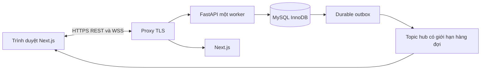

# RealtimeOrders

Ứng dụng đặt hàng và điều phối bán hàng realtime · Nhóm 17

Khách xem giá theo nhóm, đặt nhiều món rồi chờ duyệt. Người bán kiểm tra kho,
duyệt đơn, chuẩn bị và giao hàng. **Gửi đơn không giữ hàng; chỉ duyệt mới trừ kho.**
Chat riêng, thông báo lưu bền và lịch sử đơn giúp giảm trao đổi thủ công.

## Chạy bản đã cài trên máy này

Mở `Start.cmd`, dùng URL mà script in ra (mặc định **https://localhost:3443**).
Để máy khác cùng LAN truy cập, làm theo [hướng dẫn hai máy](docs/LAN.md).
Chế độ LAN dùng IP trong tệp local, proxy cổng 3443 và chứng thư CA riêng cho demo.
Dừng bằng `Stop.cmd`. Tài khoản và mật khẩu demo được sinh ngẫu nhiên, xem tại
`runtime/demo-accounts.local.json`. Tệp này chỉ có trên máy cài, không nằm trong gói source.
Không có mật khẩu admin mặc định.

Từ 23/10/2026, bản cài dùng dịch vụ MySQL `MySQL80` sẵn có tại
**`127.0.0.1:3306`**, database **`realtimeorders`**. Có thể xem bằng kết nối 3306
trong MySQL Workbench. Mã nguồn ở `D:\Dev PTIT\Lập trình mạng\RealtimeOrders`.
Start/Stop chỉ quản lý backend, frontend và proxy; không dừng MySQL của Windows.
Dữ liệu instance cũ ở cổng 3307 được giữ làm bản dự phòng, không còn là DB hoạt động.

Chứng thư localhost là chứng thư tự ký dành cho thử nghiệm. Trình duyệt có thể
yêu cầu xác nhận trước khi mở lần đầu. Không dùng chứng thư này cho triển khai công khai.

## Chức năng đã triển khai

- Đăng ký SĐT qua OTP Zalo, SMS dự phòng do người dùng chọn; đăng nhập mật khẩu, OTP khôi phục qua cấu hình SMS, xác minh email tùy chọn.
- Hai nhóm giá sinh viên/người đi làm; tối đa ba địa chỉ và một mặc định.
- Danh mục, đơn vị, sản phẩm/ảnh (tải tệp hoặc lưu URL HTTPS trong MySQL), đợt hàng và giá nhóm; giao tập trung/giao riêng có điều kiện.
- Đơn nhiều dòng, kiểm tra giá/phiên bản/phí; duyệt nguyên đơn, kho không âm.
- Hủy đơn chờ; xin hủy sau duyệt, quản trị quyết định và hoàn kho đúng một lần.
- Menu theo ngày có nhiều sản phẩm và nhiều đợt cùng ngày; tồn kho, giá và nhóm được phép mua được kiểm soát riêng.
- Giao riêng tính quãng đường bằng Goong; cần `GOONG_API_KEY` và vị trí kho/địa chỉ đã xác nhận.
- Chức năng yêu cầu hàng/báo giá đã rút khỏi phạm vi; các API cũ trả HTTP 410.
- Chat text/ảnh, lịch sử, kiểm duyệt từ cấm, thông báo lưu bền và quan tâm sản phẩm.
- Quản lý tài khoản, thu hồi phiên, báo cáo doanh thu COD khi DELIVERED, audit/ledger.
- HTTPS/WSS, topic riêng theo quyền, seq, snapshot/replay, reconnect, outbox và retry cùng mã.

**OTP chỉ chạy demo nếu chưa cấu hình nhà cung cấp**: ở `DEMO_MODE`, mã thử được hiển thị rõ trên giao diện. Để đăng ký thật cần OA/ZBS, access token và template OTP đã duyệt; SMS dự phòng và khôi phục mật khẩu cần cấu hình Twilio. Email tùy chọn cần SMTP. Không có thông tin xác thực Zalo/Twilio trong môi trường hiện tại nên chưa xác minh gửi tin thật. Đừng đưa khách thật vào chế độ demo. Không có thanh toán online, vận chuyển bên thứ ba hay đổi trả sau giao.

## Kiến trúc và công nghệ



Python 3.12; FastAPI, SQLAlchemy asyncio, asyncmy, Alembic; MySQL/InnoDB;
Next.js 16.4.2, React, TypeScript, Tailwind và Font Awesome. Phiên bản chính xác:
`backend/requirements.txt`, `frontend/package-lock.json`.
Máy thử dùng MySQL **8.0.46** đã có sẵn thay cho đề xuất 8.4; không dùng SQLite.

TCP/TLS và framing WebSocket do thư viện xử lý. Nhóm tự triển khai xác thực,
giao thức JSON v1, phân quyền topic, thứ tự sự kiện, snapshot/replay, hàng đợi giới hạn,
giao dịch kho và chống thao tác trùng. Trình duyệt không truy cập MySQL trực tiếp.

## Cài mới trên Windows

Cần Python 3.12, Node.js 24 LTS, MySQL Server 8.0.46+ hoặc 8.4.
Giải nén vào một thư mục riêng, mở PowerShell tại thư mục đó:

```powershell
powershell -NoProfile -ExecutionPolicy Bypass -File scripts\setup.ps1
powershell -NoProfile -ExecutionPolicy Bypass -File scripts\services.ps1 start
```

Khởi động MySQL trên máy trước khi setup. `setup.ps1` mặc định kết nối server
đang có ở `127.0.0.1:3306`, hỏi mật khẩu quản trị trong terminal, tạo database
`realtimeorders` mới và user riêng với mật khẩu ngẫu nhiên. Script không đổi mật
khẩu root, không khởi tạo datadir và không ghi đè database đã tồn tại.
Sau đó script chạy Alembic/seed, tạo TLS thử và build giao diện. Có thể truyền
`-MySQLPort`, `-MySQLHost`, `-AdminUser` hoặc `-AdminPasswordFile` nếu cần.
Migration `0007` thêm `product_images.source_url`; database mới tạo cũng có thể
lưu URL ảnh sau khi `setup.ps1` chạy `alembic upgrade head`.

Nếu dùng MySQL đã quản trị sẵn: tự tạo **database và user riêng**, cấp quyền trên
database đó, tạo `.env` theo `.env.example`, rồi chạy setup. Không dùng database của
ứng dụng khác. Migration `0001` là schema 38 bảng; migration đầu phải chạy trên DB trống.

Đổi bản cũ từ 3307 sang server 3306: lưu mật khẩu root của 3306 vào
`runtime/mysql-3306-admin-password.local`, rồi chạy
`.\.venv\Scripts\python.exe scripts\migrate_mysql.py`. Công cụ dừng ghi tạm thời,
dump/nhập vào database mới, đối chiếu hash cả 39 bảng rồi mới chuyển `.env`;
giữ nguyên dữ liệu nguồn và các database khác. Không chạy lại nếu đã chuyển xong.

```powershell
# Chạy từng thành phần khi phát triển
cd backend
..\.venv\Scripts\python.exe -m alembic upgrade head
..\.venv\Scripts\python.exe seed.py
..\.venv\Scripts\python.exe -m uvicorn app.main:app --host 127.0.0.1 --port 8000 --ws-max-size 65536
# Cửa sổ khác, thư mục frontend
npm ci
npm run dev
# Cửa sổ khác, thư mục project
node scripts\proxy.mjs
```

Frontend 3000 và backend 8000 chỉ nghe loopback. Người dùng vào proxy 3443.
Không thêm `--workers` vì topic hub hiện chỉ ở một process. Xem
[vận hành và bảo mật](docs/OPERATIONS.md) trước khi triển khai LAN hoặc Internet.

## Kiểm thử và thực nghiệm

Các test có ghi đơn, địa chỉ và trạng thái phiên. Cách chạy trên bản sao MySQL
riêng (cần tệp quản trị cục bộ theo hướng dẫn trong
[báo cáo kiểm thử 24/10](docs/AUDIT_2026-10-24.md)):

```powershell
powershell -NoProfile -ExecutionPolicy Bypass -File scripts\services.ps1 stop-app
npm --prefix frontend run build
.\.venv\Scripts\python.exe scripts\isolated_validation.py prepare
.\.venv\Scripts\python.exe scripts\isolated_validation.py backend
.\.venv\Scripts\python.exe scripts\isolated_validation.py browser
.\.venv\Scripts\python.exe scripts\isolated_validation.py run -- "{python}" scripts\load_test.py --clients 100 --seconds 30 --rps 10 --reconnect-fraction 0.1
.\.venv\Scripts\python.exe scripts\isolated_validation.py finish
```

Browser test dùng Edge cài trên máy; có thể đổi `channel` trong
`frontend/playwright.config.ts` nếu dùng trình duyệt khác. Test tạo dữ liệu `TEST-*`,
đóng đợt sau khi chạy, giữ lịch sử để truy vết; chỉ chạy trên DB thử.
Không gửi SMS hoặc Zalo thật trong kiểm thử/tạo tải. Giới hạn đăng nhập/OTP vẫn áp dụng khi
chạy test nhiều lần; chờ cửa sổ giới hạn thay vì tắt bảo vệ trong môi trường thật.

`prepare` từ chối chạy đè các cổng đang dùng, đối chiếu 39 bảng, dùng thư mục ảnh
riêng, buộc SMS/email demo và xóa cấu hình Zalo/Twilio/SMTP khỏi tiến trình test. `finish` kiểm tra dữ liệu nguồn rồi chạy lại bản
demo chính; giữ DB audit để kiểm tra. Kết quả backend/browser có thư mục theo
lượt chạy; phép tải giữ file riêng theo tag tại `evidence/load/`.

Kết quả và giới hạn được cập nhật trong [VALIDATION.md](docs/VALIDATION.md),
dữ liệu gốc ở `evidence/`. Các ca thử đề xuất chưa chạy vẫn được phân biệt trong
[TEST_PLAN.md](docs/TEST_PLAN.md). Tải mô phỏng cùng máy không thay thế nghiệm thu
trên hai thiết bị LAN hay thử với người mua thực tế.

## Đóng góp kỹ thuật

Đợt [tối ưu độ trễ 25/10](docs/LATENCY_2026-10-25.md) có ba lượt đo lặp lại ở
2.000 kết nối và kiểm thử hồi quy; giữ nguyên 5 phần công việc.

Phạm vi làm việc giữ nguyên [5 phần đã chốt](docs/WORKSTREAMS.md).
Đợt [tối ưu 24–25/10](docs/PERFORMANCE_2026-10-24.md) giảm truy vấn lặp và chi phí
phát sự kiện, giữ API/luồng nghiệp vụ; có phép đo trước/sau và các giới hạn thực.

1. Duyệt toàn bộ đơn trong giao dịch InnoDB, khóa theo thứ tự và ledger duy nhất;
   so với read-then-write không khóa có thể bán vượt kho.
2. Phát phần thay đổi đúng nhóm giá qua WSS, không phát giá/đơn/chat riêng sang nhóm khác;
   có công cụ so sánh baseline polling.
3. Dữ liệu, lịch sử, idempotency và event commit cùng giao dịch; outbox phục hồi
   sau restart, client replay/snapshot và gửi lại không tạo bản sao.

Đây là cải tiến của ứng dụng so với baseline tự xây, không tuyên bố thuật toán mới.

## Cấu trúc và tài liệu

```text
backend/app/           API, auth, commerce, requests, chat, realtime, outbox
backend/alembic/       migration thực thi
backend/tests/         kiểm thử MySQL + HTTPS/WSS
frontend/app/          giao diện khách hàng và quản trị
frontend/tests/        browser test
scripts/              cài/chạy/dừng, đo tải, backup/restore, đóng gói
db/schema.sql         schema đầu vào của migration 0001
docs/                 SRS, thiết kế, vận hành, giao thức, báo cáo
evidence/             kết quả kiểm thử và số liệu thực
runtime/              dữ liệu cục bộ và secrets, không nộp
```

[SRS](docs/SRS.md) · [quyết định](docs/DECISIONS.md) · [kiến trúc](docs/ARCHITECTURE.md) ·
[giao thức](docs/PROTOCOL.md) · [nguồn tham khảo](docs/SOURCES.md) · [nhóm](docs/team.json).
Các tài liệu thiết kế gốc ghi mục tiêu; [IMPLEMENTATION_STATUS.md](docs/IMPLEMENTATION_STATUS.md)
ghi rõ cách bản thực hiện khác đề xuất ban đầu và các việc cần người dùng/nhà cung cấp.

Trước nộp: nhóm xác nhận đóng góp cá nhân, chạy thử ít nhất hai thiết bị, kiểm tra
Compilatio theo yêu cầu môn học và tự nộp bản cuối. Không có kết quả Compilatio
hoặc xác nhận người dùng thật nào được tự khai trong project này.
