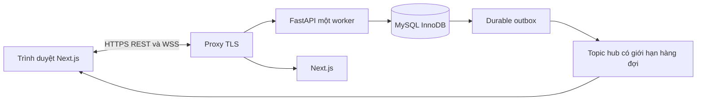

# RealtimeOrders

Ứng dụng đặt hàng và điều phối bán hàng realtime · Nhóm 17 

Khách xem giá theo nhóm, đặt nhiều món rồi chờ duyệt. Người bán kiểm tra kho,
duyệt đơn, chuẩn bị và giao hàng. **Gửi đơn không giữ hàng; chỉ duyệt mới trừ kho.**
Chat riêng, yêu cầu hàng/báo giá, thông báo và lịch sử giúp giảm trao đổi thủ công.

## Chạy bản đã cài trên máy này

Mở `Start.cmd`, sau đó truy cập **https://localhost:3443**.
Dừng bằng `Stop.cmd`. Tài khoản và mật khẩu demo được sinh ngẫu nhiên, xem tại
`runtime/demo-accounts.local.json`. Tệp này chỉ có trên máy cài, không nằm trong gói source.
Không có mật khẩu admin mặc định.

Trên máy bàn giao, MySQL lưu tại `D:\Dev PTIT\RealtimeOrders-data\mysql-data` vì
binary MySQL 8.0 Windows không mở được datadir có dấu. Mã nguồn và giao diện vẫn
ở `D:\Dev PTIT\Lập trình mạng\RealtimeOrders`; `runtime/mysql.local.json` quản lý
đường dẫn dữ liệu, nên Start/Stop không cần sửa tay.

Chứng thư localhost là chứng thư tự ký dành cho thử nghiệm. Trình duyệt có thể
yêu cầu xác nhận trước khi mở lần đầu. Không dùng chứng thư này cho triển khai công khai.

## Chức năng đã triển khai

- Đăng ký SĐT qua OTP, đăng nhập mật khẩu, khôi phục mật khẩu, xác minh email tùy chọn.
- Hai nhóm giá sinh viên/người đi làm; tối đa ba địa chỉ và một mặc định.
- Danh mục, đơn vị, sản phẩm/ảnh, đợt hàng và giá nhóm; giao tập trung/giao riêng có điều kiện.
- Đơn nhiều dòng, kiểm tra giá/phiên bản/phí; duyệt nguyên đơn, kho không âm.
- Hủy đơn chờ; xin hủy sau duyệt, quản trị quyết định và hoàn kho đúng một lần.
- Yêu cầu hàng → tiếp nhận → báo giá có hạn → chấp thuận → một đơn liên kết.
- Chat text/ảnh, lịch sử, kiểm duyệt từ cấm, thông báo lưu bền và quan tâm sản phẩm.
- Quản lý tài khoản, thu hồi phiên, báo cáo doanh thu COD khi DELIVERED, audit/ledger.
- HTTPS/WSS, topic riêng theo quyền, seq, snapshot/replay, reconnect, outbox và retry cùng mã.

**SMS/email hiện chạy demo**: mã hiển thị rõ trên giao diện, chưa gửi thật. Có adapter
Twilio và SMTP; cần thông tin dịch vụ để kiểm tra với số/email được phép. Đừng đưa
khách thật vào chế độ demo. Không có thanh toán online, vận chuyển bên thứ ba hay đổi trả sau giao.

## Kiến trúc và công nghệ



Python 3.12; FastAPI, SQLAlchemy asyncio, asyncmy, Alembic; MySQL/InnoDB;
Next.js 16.4.2, React, TypeScript, Tailwind và Font Awesome. Phiên bản chính xác:
`backend/requirements.txt`, `frontend/package-lock.json`.
Máy thử dùng MySQL **8.0.46** đã có sẵn thay cho đề xuất 8.4; không dùng SQLite.

TCP/TLS và framing WebSocket do thư viện xử lý. Nhóm tự triển khai xác thực,
giao thức JSON v1, phân quyền topic, thứ tự sự kiện, snapshot/replay, hàng đợi giới hạn,
giao dịch kho và chống thao tác trùng. Trình duyệt không truy cập MySQL trực tiếp.

## Cài mới trên Windows

Cần Python 3.12, Node.js 24 LTS, MySQL Server 8.0.46+ hoặc 8.4.
Giải nén vào một thư mục riêng, mở PowerShell tại thư mục đó:

```powershell
powershell -NoProfile -ExecutionPolicy Bypass -File scripts\setup.ps1
powershell -NoProfile -ExecutionPolicy Bypass -File scripts\services.ps1 start
```

`setup.ps1` tạo venv, cài dependency khóa phiên bản, khởi tạo **instance MySQL riêng**
tại `runtime/mysql-data`, cổng 3307; tạo mật khẩu ngẫu nhiên, chạy Alembic/seed,
tạo TLS thử và build giao diện. Nếu cổng 3307 đang dùng, script dừng để tránh sửa
database khác. Có thể truyền `-MySQLBinary '...\mysqld.exe'` nếu cài ở vị trí khác.
Nếu đường dẫn project có dấu, setup chọn thư mục `RealtimeOrders-data` tại phần
đường dẫn cha chỉ có ASCII. Có thể chỉ định `-MySQLDataDirectory` riêng; không
dùng thư mục của một database đang tồn tại.

Nếu dùng MySQL đã quản trị sẵn: tự tạo **database và user riêng**, cấp quyền trên
database đó, tạo `.env` theo `.env.example`, rồi chạy setup. Không dùng database của
ứng dụng khác. Migration `0001` là schema 38 bảng; migration đầu phải chạy trên DB trống.

```powershell
# Chạy từng thành phần khi phát triển
cd backend
..\.venv\Scripts\python.exe -m alembic upgrade head
..\.venv\Scripts\python.exe seed.py
..\.venv\Scripts\python.exe -m uvicorn app.main:app --host 127.0.0.1 --port 8000 --ws-max-size 65536
# Cửa sổ khác, thư mục frontend
npm ci
npm run dev
# Cửa sổ khác, thư mục project
node scripts\proxy.mjs
```

Frontend 3000 và backend 8000 chỉ nghe loopback. Người dùng vào proxy 3443.
Không thêm `--workers` vì topic hub hiện chỉ ở một process. Xem
[vận hành và bảo mật](docs/OPERATIONS.md) trước khi triển khai LAN hoặc Internet.

## Kiểm thử và thực nghiệm

Khởi động ứng dụng, sau đó:

```powershell
cd backend
..\.venv\Scripts\python.exe -m pytest -q
cd ..\frontend
npm run build
npx playwright test
cd ..
.\.venv\Scripts\python.exe scripts\load_test.py --clients 100 --seconds 30 --rps 10
.\.venv\Scripts\python.exe scripts\backup.py
```

Browser test dùng Edge cài trên máy; có thể đổi `channel` trong
`frontend/playwright.config.ts` nếu dùng trình duyệt khác. Test tạo dữ liệu `TEST-*`,
đóng đợt sau khi chạy, giữ lịch sử để truy vết; chỉ chạy trên DB thử.
Không gửi SMS thật trong kiểm thử/tạo tải. Giới hạn đăng nhập/OTP vẫn áp dụng khi
chạy test nhiều lần; chờ cửa sổ giới hạn thay vì tắt bảo vệ trong môi trường thật.

Kết quả và giới hạn được cập nhật trong [VALIDATION.md](docs/VALIDATION.md),
dữ liệu gốc ở `evidence/`. Các ca thử đề xuất chưa chạy vẫn được phân biệt trong
[TEST_PLAN.md](docs/TEST_PLAN.md). Tải mô phỏng cùng máy không thay thế nghiệm thu
trên hai thiết bị LAN hay thử với người mua thực tế.

## Đóng góp kỹ thuật

1. Duyệt toàn bộ đơn trong giao dịch InnoDB, khóa theo thứ tự và ledger duy nhất;
   so với read-then-write không khóa có thể bán vượt kho.
2. Phát phần thay đổi đúng nhóm giá qua WSS, không phát giá/đơn/chat riêng sang nhóm khác;
   có công cụ so sánh baseline polling.
3. Dữ liệu, lịch sử, idempotency và event commit cùng giao dịch; outbox phục hồi
   sau restart, client replay/snapshot và gửi lại không tạo bản sao.

Đây là cải tiến của ứng dụng so với baseline tự xây, không tuyên bố thuật toán mới.

## Cấu trúc và tài liệu

```text
backend/app/           API, auth, commerce, requests, chat, realtime, outbox
backend/alembic/       migration thực thi
backend/tests/         kiểm thử MySQL + HTTPS/WSS
frontend/app/          giao diện khách hàng và quản trị
frontend/tests/        browser test
scripts/              cài/chạy/dừng, đo tải, backup/restore, đóng gói
db/schema.sql         schema đầu vào của migration 0001
docs/                 SRS, thiết kế, vận hành, giao thức, báo cáo
evidence/             kết quả kiểm thử và số liệu thực
runtime/              dữ liệu cục bộ và secrets, không nộp
```

[SRS](docs/SRS.md) · [quyết định](docs/DECISIONS.md) · [kiến trúc](docs/ARCHITECTURE.md) ·
[giao thức](docs/PROTOCOL.md) · [nguồn tham khảo](docs/SOURCES.md) · [nhóm](docs/team.json).
Các tài liệu thiết kế gốc ghi mục tiêu; [IMPLEMENTATION_STATUS.md](docs/IMPLEMENTATION_STATUS.md)
ghi rõ cách bản thực hiện khác đề xuất ban đầu và các việc cần người dùng/nhà cung cấp.

Trước nộp: nhóm xác nhận đóng góp cá nhân, chạy thử ít nhất hai thiết bị, kiểm tra
Compilatio theo yêu cầu môn học và tự nộp bản cuối. Không có kết quả Compilatio
hoặc xác nhận người dùng thật nào được tự khai trong project này.
