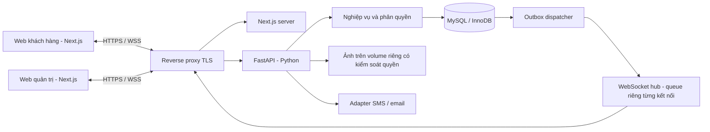

# Kiến trúc và các luồng quan trọng

## 1. Thành phần



Đề xuất một origin: `/` tới Next.js, `/api/v1/*` và `/ws/v1` tới FastAPI.
Reverse proxy kết thúc TLS, chuyển tiếp nâng cấp WebSocket và giới hạn upload.
Next.js khuyến nghị reverse proxy khi tự host; xem [tài liệu chính thức](https://nextjs.org/docs/app/guides/self-hosting).
Không expose MySQL ra trình duyệt; không dùng route Next.js làm backend nghiệp
vụ thứ hai để rồi có hai nơi quyết định tồn kho.

Các module backend: auth, accounts, catalog, delivery, orders, requests, chat,
moderation, notifications, reports, realtime. Đây là module trong cùng ứng dụng,
không phải microservice. Frontend có khu `(customer)` và `/admin`, dùng chung
client HTTP, hook WSS, kiểu DTO và component cơ bản.

## 2. Bất biến dữ liệu và transaction

- InnoDB là nguồn sự thật. Lock trong Python không bảo vệ được dữ liệu khi có
  nhiều process hoặc yêu cầu đi vào các kết nối DB khác nhau.
- Một `AsyncSession` riêng cho mỗi request/task, không dùng chung session cho
  các coroutine song song. Xem [SQLAlchemy async](https://docs.sqlalchemy.org/en/21/orm/extensions/asyncio.html).
- Idempotency, inventory movement, lịch sử, thông báo và event liên quan cùng
  transaction với thay đổi nghiệp vụ; commit trước phản hồi thành công.
- Mọi thay đổi ảnh hưởng thống kê offer (kể cả tạo/hủy PENDING) đều khóa offer
  trước khi đổi dữ liệu và tính aggregate. Nghiệp vụ dùng READ COMMITTED; snapshot
  có consistent-read transaction riêng để dữ liệu và heads chung ranh giới.
- Không gọi SMS, tải ảnh, chờ WebSocket hoặc gọi HTTP ngoài khi đang giữ lock.
- Lock order nhất quán: idempotency → account liên quan tăng dần ID →
  order/request đang xử lý → offer tăng dần ID → delivery/price cần khóa →
  stream head tăng dần topic. Các service không được giữ stream lock rồi quay
  lại xin lock order. Nếu cần biết chủ đơn, đọc ID chủ trước, khóa các account
  theo thứ tự rồi mới khóa order và kiểm tra lại; quyền sở hữu đơn là bất biến.
- Duyệt/hủy/khóa tài khoản cùng dùng thứ tự trên. Sửa giá phải khóa offer trước
  price row, không đi ngược thứ tự của checkout. Kiểm thử cả contention và
  deadlock; không suy ra không thể deadlock chỉ từ việc có quy ước thứ tự.

`SELECT ... FOR UPDATE` phải ở trong transaction. InnoDB giữ lock tới commit/
rollback; [locking reads](https://dev.mysql.com/doc/refman/8.4/en/innodb-locking-reads.html)
là cơ sở của thiết kế duyệt kho. Không dùng `SKIP LOCKED` để giả định hàng bị
khóa là hết hàng; tùy chọn này dành cho đọc queue outbox.

## 3. Đặt và duyệt đơn

### Đặt đơn

1. Xác thực, kiểm tra address thuộc khách và còn hợp lệ; server lấy nhóm giá.
2. Bảo vệ idempotency `(actor, scope, key)` bằng unique key trong transaction.
3. Lock/read các offer và giá, chính sách giao theo thứ tự xác định. Kiểm tra
   bước số lượng, phiên bản giá/phí, đợt còn nhận đơn. Không nhận tổng tiền tự tính
   từ frontend như giá trị có thẩm quyền.
4. Tạo PENDING, chụp thông tin từng dòng và giao hàng; không trừ kho.
5. Lưu history, notification, stream event và outbox; commit; trả đơn + version.
6. Dispatcher phát sau commit. Chỉ số đang chờ đổi làm catalog version đổi,
   nhưng `availableQty` không đổi.

### Duyệt

```text
BEGIN
  claim_or_read_idempotency(actor, scope, key, request_hash)
  lock_involved_accounts_in_id_order_and_check_active()
  SELECT order WHERE id = :id FOR UPDATE
  require PENDING and expected_version = order.version
  SELECT offer ... FOR UPDATE       -- từng khóa theo ID tăng dần
  require every available_qty >= ordered_qty
  UPDATE offers SET available_qty = available_qty - :qty, version = version + 1
  INSERT inventory_movements        -- UNIQUE(kind, reference_id, offer_id)
  UPDATE orders SET status = APPROVED, version = version + 1
  INSERT order_status_history, notifications
  append_durable_events_and_outbox()
  complete_idempotency_with_response()
COMMIT
return success
```

Ví dụ còn 10 kg, hai đơn 7 kg và 6 kg: nếu cùng duyệt, một transaction kiểm tra
sau khi transaction kia commit sẽ thấy lượng còn mới. Không transaction nào được
ghi tồn âm. Nếu một đơn nhiều dòng thiếu một dòng, không trừ các dòng còn lại.

Nếu request dùng ID cũ, trả kết quả cũ sau kiểm tra quyền; đổi body cùng key trả
`IDEMPOTENCY_CONFLICT`. Nếu khác key nhưng duyệt cùng đơn, trạng thái/version
và unique movement vẫn chặn lần trừ thứ hai. Deadlock/lock timeout được phân
biệt với thiếu kho, retry giới hạn (đề xuất 3 lần), giữ nguyên key.

### Hủy và giao

Yêu cầu hủy sau duyệt không tăng kho. Khi admin chấp thuận, lock order, kiểm tra
APPROVED/PREPARING và OPEN request, lock offer theo ID, tăng đúng lượng đã trừ,
ghi movement CANCEL_RESTORE, history, event và kết quả idempotency cùng transaction.
Không được hoàn nếu movement APPROVE chưa tồn tại. SHIPPING cạnh tranh cùng
lock/version và bị chặn khi có yêu cầu hủy OPEN; chỉ một quyết định hợp lệ.
Offer đã đóng nhận đơn vẫn được hoàn vào row cũ, không tự mở bán lại.

## 4. Stream có thứ tự và outbox

Không dùng ID tự tăng toàn cục của outbox làm cursor client: ID có thể được cấp
trước khi transaction commit, trong khi transaction có ID lớn hơn commit trước.

Thiết kế đề xuất dùng `stream_heads(topic, last_seq)` và
`stream_events(topic, seq, event_id, payload)`. Transaction khóa head theo thứ tự
topic, tăng seq và lưu event cùng thay đổi nghiệp vụ. Transaction tiếp theo trên
cùng topic đợi transaction trước kết thúc, nên không bỏ qua seq chưa commit.
Seq của các topic khác nhau không dùng để so thứ tự toàn hệ thống.

Topic do server suy ra: `catalog:<groupId>`, `user:<userId>`, `admin:ops`.
Catalog DTO chỉ có giá của nhóm tương ứng. Đơn/chat/địa chỉ riêng nằm ở user
stream và admin stream; không đưa vào catalog. Thay đổi quyền/nhóm thu hồi phiên
cũ và bắt đồng bộ lại bằng danh sách topic mới.

Outbox tham chiếu event đã lưu. Dispatcher thuê lô pending bằng transaction ngắn,
đọc từng topic theo seq, enqueue tới hub rồi đánh dấu đã phát. Chết sau enqueue
nhưng trước đánh dấu có thể phát lại: client loại trùng theo topic/seq/eventId.
“Đã phát outbox” không đồng nghĩa mọi trình duyệt đã nhận hoặc render; replay
từ DB xử lý khoảng thiếu. Khởi động lại thu hồi lease hết hạn và tiếp tục phát.

Hàng mới có thể có 2.000 người theo dõi: transaction mở bán lưu thêm một
`notification_jobs` bền vững thay vì giữ lock để tạo 2.000 thông báo ngay.
Worker chia người nhận thành lô đề xuất 100; mỗi lô lưu notifications, user
events/outbox và cursor của job cùng transaction. Unique theo user/fact/kind
chặn tạo trùng khi chạy lại. Không đánh dấu job xong trước khi lưu hết lô.
Thông báo đơn/chat cho một vài người vẫn lưu ngay trong transaction nghiệp vụ.

## 5. Kết nối lại và client chậm

1. Client có model trong RAM gửi cursor mỗi topic; reload không có model thì xin
   snapshot dù localStorage còn cursor.
2. Server kiểm tra session/Origin, đăng ký live buffer trước khi chốt ranh giới
   đồng bộ. Snapshot lấy trong một consistent-read transaction, gồm dữ liệu và
   head tại cùng thời điểm; kết thúc transaction trước khi truyền qua mạng.
3. Replay/snapshot có `SYNC_BEGIN` và `SYNC_END`. Trong lúc gửi, buffer thay đổi
   sau ranh giới; xả đúng seq, loại trùng; thiếu seq thì đọc replay hoặc resync.
4. Snapshot chỉ là working set: catalog đang mở có phân trang, đơn đang mở và
   trang thông báo gần nhất. Lịch sử dài đọc API phân trang; dữ liệu chi tiết đang
   mở được tải lại theo version. Không khẳng định snapshot chứa toàn DB.
5. Quá 500 event, 256 KiB hoặc lịch sử không còn thì snapshot; không tin cursor
   lớn hơn head. Tràn live buffer thì bắt đầu lại đồng bộ, không báo đã hội tụ.
6. Queue mỗi socket đề xuất 128 frame/512 KiB, frame JSON tối đa 64 KiB. Producer
   nghiệp vụ không đợi người nhận chậm; đóng riêng socket quá tải bằng 1013.
   Sync task riêng được chờ queue có timeout, không giữ transaction DB.

Frame snapshot chia mục tiêu 32 KiB; không gửi ảnh binary/Base64 qua WSS.
Encode một lần cho cùng topic, tái dùng bytes; có thể gom batch tối đa 20 event
trong 50 ms nhưng vẫn giữ đủ seq. Không bỏ event riêng tư hoặc nhảy cursor để
che hiện tượng mất dữ liệu. WebSocket trình duyệt cần giới hạn ở mức ứng dụng
vì API cổ điển không tự xử lý backpressure: [MDN](https://developer.mozilla.org/en-US/docs/Web/API/WebSockets_API).

## 6. Quy mô triển khai

Ban đầu một worker FastAPI + dispatcher cùng process; nhiều coroutine socket,
DB pool có trần đề xuất 20 connection + 10 overflow, queue có giới hạn. 2.000
socket không tương ứng 2.000 connection DB và không có một thread DB mỗi socket.
Kích thước pool phải điều chỉnh bằng số đo, không tự tăng tới số người dùng.

Manager trong RAM chỉ hoạt động trong một process, như lưu ý của
[FastAPI](https://fastapi.tiangolo.com/advanced/websockets/). Trước nhiều worker,
cần bus chung (ví dụ Redis), router fan-out, rate limit chung và thử worker chết.
Pub/sub hỗ trợ phát live; MySQL stream vẫn chịu trách nhiệm replay bền vững.
Không chỉ đổi số worker rồi tuyên bố đã scale.

## 7. Xác thực và media

Session opaque có hash ở DB; cookie HttpOnly/Secure/SameSite, không lưu token
trong URL WebSocket/localStorage. HTTP mutation có kiểm tra Origin và CSRF token
theo session; WSS kiểm tra Origin chính xác và cookie trước khi accept. Quyền
được kiểm tra cho từng command, không chỉ lúc handshake; xem
[OWASP WebSocket Security](https://cheatsheetseries.owasp.org/cheatsheets/WebSocket_Security_Cheat_Sheet.html).

Hash/verify mật khẩu (đề xuất Argon2id) chạy ngoài event loop bằng executor có
trần; không giữ DB connection/lock trong lúc tính hash. Rate limit login và số
job hash đồng thời ngăn đợt đăng nhập làm nghẽn tất cả socket đang hoạt động.

Ảnh upload qua HTTPS, kiểm tra nội dung decode được, re-encode và bỏ metadata.
Media chat tải qua endpoint có kiểm tra thành viên hội thoại; không mở public
volume ảnh chat. OTP/SMS là adapter ngoài transaction: lưu challenge/giới hạn,
gọi provider, ghi kết quả; nếu gửi thất bại trả lỗi, không nói OTP đã được gửi.
