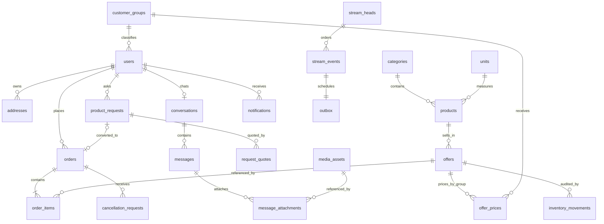

# Mô hình dữ liệu MySQL

Tham chiếu [schema.sql](../db/schema.sql) cho revision 0001. Alembic là nguồn migration thực thi.
Bản phát triển đã được kiểm tra trên MySQL 8.0.46; repository hiện có các revision 0001–0008.
Revision 0002 bổ sung
`request_quotes.item_snapshot` để giữ tên sản phẩm và đơn vị đã báo giá;
không sửa tại chỗ schema ban đầu để tránh lệch bản đã cài. Các quy tắc nhiều
dòng vẫn phải được bảo vệ bằng transaction và test,
không coi một CHECK đơn giản thay thế được toàn bộ nghiệp vụ.

Revision 0004 bổ sung `sku_sequences`. Mã mới được server cấp theo dạng
`SKU-000001`; bộ đếm được khóa trong transaction nên các yêu cầu thêm sản phẩm
đồng thời không nhận trùng SKU. Migration khởi tạo bộ đếm sau mã số lớn nhất đã
có theo định dạng này; các SKU cũ khác định dạng vẫn được giữ nguyên.

Revision 0005 bổ sung `offers.allowed_group_ids` để giới hạn từng sản phẩm trong
menu ngày. Giá trị NULL không thêm giới hạn; quyền hiệu lực vẫn giao với quyền
của sản phẩm, menu ngày và nhóm có giá bán.

Revision 0006 bổ sung `auth_challenges.delivery_channel`,
`delivery_accepted_at` và `sms_fallback_used_at`. Thông tin này dùng để xác định
kênh OTP đăng ký và cho phép chuyển một lần từ Zalo sang SMS; không lưu mã OTP
thô. Các challenge email cũ được gán kênh EMAIL khi migration.

Revision 0007 bổ sung URL HTTPS cho ảnh sản phẩm.
Revision 0008 cho phép nhiều menu/đợt bán trong cùng ngày.
Luôn chạy Alembic đến head, không chỉ áp dụng revision 0001.

## 1. Quy ước

- MySQL 8.0 trở lên, InnoDB, utf8mb4. ID UUID chuẩn hóa; timestamp DATETIME(6) UTC.
  `sale_date` và báo cáo nhóm theo Asia/Ho_Chi_Minh.
- Số lượng DECIMAL(12,3), tiền VND DECIMAL(18,0); unit price theo đơn vị VND.
  API/DTO dùng chuỗi; tính tiền bằng Decimal, làm tròn từng dòng rồi cộng.
- FK không cascade xóa lịch sử kinh doanh. User/product/address dùng trạng
  thái hoặc deleted_at. Snapshot đơn không phụ thuộc dữ liệu hiện tại.
- Trường version tăng khi sửa; business transition phải có expectedVersion.
- Đề xuất connection nghiệp vụ dùng READ COMMITTED + khóa tường minh; snapshot
  đồng bộ dùng transaction read-only REPEATABLE READ/consistent snapshot riêng.
  Không để truy vấn aggregate đọc snapshot cũ sau khi lock-read đã thấy kho mới.
- UUID/enum trong DDL là cấu trúc thiết kế, chưa có tài khoản/giá/OTP thật.

## 2. Quan hệ chính

Một khách tạo hội thoại khi dùng chat lần đầu. Schema unique customer_id ngăn
tạo hai hộp chat riêng cho cùng khách.

## 3. Nhóm bảng

| Nhóm | Bảng | Trách nhiệm |
|---|---|---|
| Tài khoản | customer_groups, users, addresses | Nhóm giá, định danh, tối đa 3 địa chỉ và mặc định |
| Xác thực | auth_challenges, sessions, rate_limit_buckets | OTP/ticket, kênh gửi, thời gian Zalo-accepted/fallback, hash session và giới hạn dùng chung |
| Hàng | categories, units, products, product_images, media_assets | SKU/đơn vị/ảnh có ownership và vòng đời |
| Bán theo đợt | offers, offer_prices | Số còn, cửa sổ bán/duyệt, quyền theo dòng và giá nhóm |
| Giao hàng | delivery_zones, delivery_policies, pickup_slots | Khu vực, phí/mức tối thiểu và điểm giao tập trung |
| Đơn | orders, order_items, order_status_history | Snapshot thương mại, phiên bản và lịch sử |
| Kho/hủy | inventory_movements, cancellation_requests | Sổ tăng/giảm, yêu cầu và quyết định hủy |
| Yêu cầu hàng | product_requests, request_quotes, request_status_history | Báo giá được chấp thuận, liên kết đơn duy nhất |
| Chat | conversations, messages, message_attachments | Một hộp chat/khách, text đã che và ảnh được phép |
| Thông báo | notifications, product_subscriptions, notification_jobs | Lịch sử riêng, quan tâm và fan-out bền vững theo lô |
| Quản trị | moderation_rules, moderation_violations, audit_logs, system_settings, sku_sequences | Chính sách, nhật ký và cấp SKU tăng dần |
| Tin cậy | idempotency_keys, stream_heads, stream_events, outbox | Retry, cursor đúng commit và phát lại |

## 4. Ràng buộc quan trọng

1. `users.phone_e164`, `users.email_normalized` unique kể cả tài khoản bị xóa mềm.
   Email NULL được phép nhiều user; chỉ email đã xác minh được gắn vào users.
2. `users.default_address_id` có FK kép với `(user_id,id)` của addresses, đảm bảo
   default thuộc chính user. Thêm/xóa/set-default khóa user trước đếm địa chỉ;
   cùng transaction kiểm tra ≤3 địa chỉ chưa xóa và không trỏ default đã xóa.
3. `offer_prices(offer_id,group_id)` unique. Sửa giá tăng price.version và
   offer.version. Số lượng phải là bội quantity_step của SKU, không chỉ >0.
4. `orders(customer_id,client_order_id)` unique bền vững, chống tạo lại cả khi
   idempotency cache đã hết hạn. Order giữ request_hash gốc: cùng clientOrderId
   nhưng khác body trả conflict, không coi là retry hợp lệ.
   `order_items(order_id,offer_id)` unique.
5. `inventory_movements(kind,reference_id,offer_id)` unique: approve/restock của
   một đơn không ghi hai lần. Manual adjust dùng referenceId UUID riêng và lý do.
6. `orders.source_request_id` unique nullable: một yêu cầu chỉ sinh một đơn.
   Quote và request vẫn có FK/nghiệp vụ kiểm tra rằng quote thuộc đúng request.
7. `messages(sender_id,client_message_id)` unique; attachment dùng FK asset và
   kiểm tra sender sở hữu ảnh READY đúng purpose CHAT trong nghiệp vụ.
8. `cancellation_requests.open_order_id` generated + unique chỉ cho một yêu cầu
   OPEN trên một đơn; có thể giữ nhiều bản ghi quyết định lịch sử.
9. `notifications(user_id,source_event_id,kind)` unique chống thông báo trùng.
10. `stream_events(topic,seq)` và event_id unique; head/topic được khóa khi cấp
    seq. ID tăng của outbox chỉ dùng nội bộ, không làm cursor của client.

`notifications.source_event_id` là UUID của **sự kiện nghiệp vụ nguồn** (fact),
không bắt buộc là một stream event: cùng fact có thể sinh event riêng ở nhiều
topic, với eventId khác nhau. Không đặt FK tới stream để có thể giữ thông báo
lâu hơn lịch sử replay. Job thông báo hàng mới cũng unique theo fact/kind.

## 5. Snapshot và vòng đời

`orders`: group snapshot, delivery/address snapshot, shipping fee, merchandise
total, total, policy version và mốc thời gian trạng thái. `order_items`: tên
SKU, đơn vị, số lượng, unit price/price version và line total. Không lấy lại giá
hiện tại để dựng hóa đơn/chi tiết đơn cũ.

Offers có DRAFT/OPEN/CLOSED và `processing_locked_at`: CLOSED ngừng đơn mới;
các đơn đã đặt được duyệt khi chưa khóa xử lý. Không khóa xử lý khi vẫn còn
PENDING cần quyết định. Hoàn kho vào offer cũ được ghi ledger kể cả đợt đã đóng,
nhưng không tự mở lại hoặc gộp sang offer ngày mới.

Ảnh upload chưa gắn tài nguyên có thời hạn dọn dẹp; không xóa ảnh đang được
tham chiếu. Tin nhắn bị che lưu text đã lọc; raw vi phạm trong bảng hạn chế quyền,
đề xuất retention 30 ngày, có cấu hình. Không lưu raw OTP/session/password.

## 6. Truy vấn và chỉ số

- Catalog: đọc offer đang bán theo thời gian, join giá của đúng nhóm và tổng hợp
  pending/approved theo index; tính một lần mỗi thay đổi để phát, không chạy lại
  toàn bộ truy vấn cho từng trong 2.000 socket.
- Số khách chờ là COUNT DISTINCT customer có đơn PENDING theo offer, không phải
  số dòng hoặc số lượt click. Số đơn đã duyệt hiện hành gồm APPROVED/PREPARING/
  SHIPPING/DELIVERED, bỏ đơn đã hủy; tổng lịch sử duyệt là chỉ số khác.
- History/chat/notifications phân trang bằng `(created_at,id)` hoặc seq ổn định.
- Báo cáo doanh thu: lọc `delivered_at >= utc_start AND delivered_at < utc_end`;
  tính biên từ ngày/tháng địa phương, không DATE(timestamp UTC) một cách tùy ý.
  Phí giao và doanh thu hàng tách riêng; chưa bao gồm kế toán/hoàn tiền sau giao.
- Dùng EXPLAIN và số đo trước thêm index. Không giải quyết pool bão hòa bằng
  mở 2.000 DB connection tương ứng socket.

## 7. Lưu trữ và phục hồi

Stream event giữ tối thiểu thời gian đã cấu hình (đề xuất 24 giờ); xóa lịch sử
không giảm head. Replay đòi gap còn đủ và vừa giới hạn; nếu thiếu thì snapshot.
Idempotency giữ đề xuất 7 ngày; unique trên domain vẫn là lớp bảo vệ lâu dài.
Outbox chỉ dọn bản đã phát sau thời gian lưu; pending không bị dọn theo TTL.
Xóa outbox PUBLISHED đủ hạn trước khi xóa stream event tương ứng; event còn
outbox pending/leased hoặc job chưa xử lý không được dọn mất tham chiếu.

Backup/restore phải thử trên DB riêng, ghi checksum và số hàng/mốc stream; không
thử restore đè dữ liệu làm việc. Chính sách vận hành dài hạn phụ thuộc hạ tầng,
chưa được xác nhận là dịch vụ đã triển khai.
