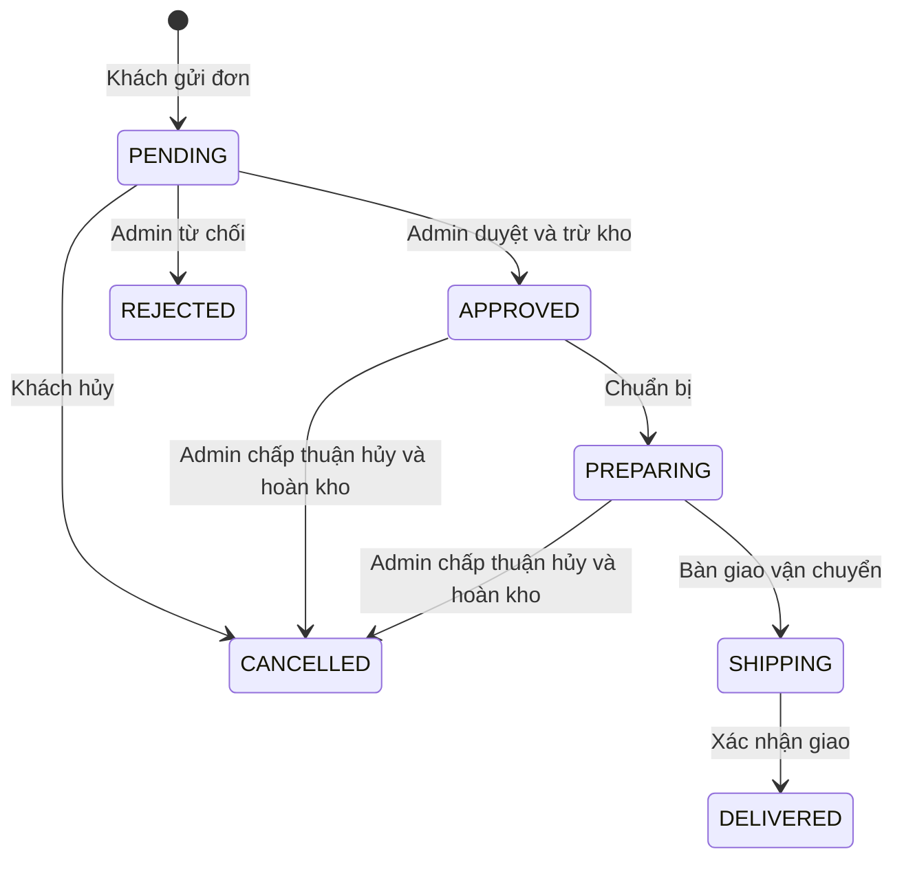

# SRS — Đặc tả yêu cầu RealtimeOrders

> Cập nhật theo lựa chọn người dùng ngày 30/10/2026: đăng ký OTP qua Zalo trước,
> SMS là kênh dự phòng do người dùng chọn; OTP khôi phục mật khẩu giữ luồng SMS.
> Các thay đổi menu theo ngày và tích hợp OpenStreetMap/OSRM được mô tả trong DAILY_SALES.md.
> Quyết định 29/10/2026: FR12 và mục 3.4 về yêu cầu hàng/báo giá thuộc bản thiết kế ban đầu, đã rút khỏi phạm vi triển khai; API cũ trả HTTP 410. Luồng menu theo ngày thay thế quy trình này.

Phiên bản thiết kế 0.1 · 22/10/2026 · Nhóm 17 · Ngô Văn Quyền.
Nguồn và thứ tự quyết định: [DECISIONS.md](DECISIONS.md), [SOURCES.md](SOURCES.md).
Đây là đặc tả đề xuất để triển khai, không phải biên bản đã nghiệm thu.

## 1. Bài toán và mục tiêu

Người bán mở bán hàng theo ngày/đợt với số lượng có hạn. Khách có chính sách
giá/giao hàng theo nhóm, gửi đơn rồi chờ người bán duyệt. Hệ thống cần giữ đúng
tồn kho khi nhiều đơn được duyệt, đồng bộ trạng thái tới đúng người và lưu lại
thông tin khi mất kết nối. Động lực sử dụng là mua được hàng, giảm trao đổi thủ
công và giúp người bán điều phối giao hàng, có thể kiểm chứng bằng dùng thử.

Đầu vào: mặt hàng/đợt bán/giá, tài khoản/nhóm, địa chỉ, đơn, yêu cầu hàng và chat.
Đầu ra: đơn được xử lý, tồn kho nhất quán, thông báo/hội thoại, lịch sử và báo cáo.
Server quyết định quyền, giá, phí, tồn kho và trạng thái. Trình duyệt không truy
cập DB hoặc tự quyết định giá trị thanh toán.

## 2. Vai trò và quyền

| Người dùng | Quyền |
|---|---|
| Chưa xác thực | Đăng ký, OTP, đăng nhập, khôi phục mật khẩu; không xem dữ liệu mua hàng riêng |
| Khách đã xác minh | Hồ sơ/địa chỉ, danh sách giá của nhóm mình, đặt/theo dõi đơn của mình, yêu cầu hàng, chat riêng và thông báo |
| Quản trị | Hàng/đợt bán/nhóm giá/chính sách giao, duyệt và giao hàng, tài khoản, chat, kiểm duyệt và báo cáo |

Nhóm sinh viên/người đi làm là **nhóm giá**, không phải vai trò cấp quyền.
Admin không được tạo từ form đăng ký công khai. Tài khoản admin đầu tiên tạo
bằng tác vụ quản trị cục bộ có mật khẩu riêng, không có mật khẩu mặc định.

## 3. Yêu cầu chức năng

| ID | Yêu cầu và tiêu chí chấp nhận |
|---|---|
| FR01 | Đăng ký bắt buộc SĐT và OTP; ưu tiên ZBS Template Message qua Zalo, cho chọn SMS khi Zalo từ chối hoặc sau 60 giây; OTP sai/hết hạn/quá số lần không tạo tài khoản hoạt động; hai đăng ký đồng thời cùng SĐT chỉ tạo một user |
| FR02 | Đăng nhập bằng SĐT hoặc email đã xác minh và mật khẩu; mật khẩu được hash; khóa/xóa mềm/đăng xuất/idle timeout thu hồi phiên và WSS |
| FR03 | Tối đa 3 địa chỉ hoạt động và một địa chỉ mặc định; hai lần thêm đồng thời không vượt 3; cần ít nhất một địa chỉ trước khi đặt hàng |
| FR04 | Admin quản lý nhóm, giá và khóa/mở/xóa mềm tài khoản; mỗi thay đổi có người thực hiện, thời điểm và trạng thái trước/sau |
| FR05 | CRUD danh mục, đơn vị, SKU và tối đa 5 ảnh mỗi sản phẩm (tệp tải lên hoặc URL HTTPS); tạo đợt mở bán theo ngày; dữ liệu đã được tham chiếu không bị xóa vật lý làm hỏng lịch sử |
| FR06 | Giá lấy từ nhóm hiệu lực do server xác định; thông tin còn kho, khách/đơn chờ và đơn đã duyệt được phân biệt rõ, cập nhật realtime |
| FR07 | Giao tập trung sinh viên miễn phí theo điểm/khung giờ; giao riêng kiểm tra khu vực, mức tối thiểu và phí; giá/phí được hiển thị trước xác nhận |
| FR08 | Đặt nhiều sản phẩm; server xác nhận số lượng theo bước đơn vị, giá/phiên bản và phí; lưu snapshot tên/đơn vị/giá/nhóm/địa chỉ; gửi đơn không giữ hoặc trừ kho |
| FR09 | Admin duyệt trong transaction kiểm tra lại mọi dòng; đủ hàng mới trừ kho và đổi trạng thái; một dòng thiếu làm cả đơn không được duyệt; kho không âm |
| FR10 | Có PENDING, APPROVED, REJECTED, PREPARING, SHIPPING, DELIVERED, CANCELLED; chỉ cho chuyển hợp lệ, lưu lịch sử; hai người cập nhật cùng phiên bản không ghi đè nhau |
| FR11 | Khách hủy PENDING; APPROVED/PREPARING gửi yêu cầu, admin xác nhận trước SHIPPING rồi hoàn đúng lượng đã trừ đúng một lần; yêu cầu bị từ chối giữ nguyên đơn |
| FR12 | Yêu cầu mặt hàng có quy trình riêng: gửi/tiếp nhận/báo giá/chấp thuận/từ chối; khi chốt tạo đơn từ giá đã đồng ý; liên kết truy vết và không chuyển hai lần |
| FR13 | Chat một khách với người bán; gửi text/ảnh, nhận realtime, lưu lịch sử; gửi lại cùng ID không nhân đôi; khách không đọc hội thoại người khác |
| FR14 | Thông báo trong website về hàng/đơn/yêu cầu/chat; có đã đọc/chưa đọc; đăng ký quan tâm sản phẩm; offline không đẩy kênh ngoài, khi online đọc lại |
| FR15 | Admin quản lý từ cấm; server che từ trong tên hiển thị, chat, yêu cầu và ghi chú; cảnh báo người gửi, ghi vi phạm và báo admin; không chỉ lọc ở frontend |
| FR16 | Báo cáo theo ngày/tháng: đơn từng trạng thái, hàng bán, doanh thu hàng và phí giao; đề xuất ghi doanh thu khi DELIVERED, không tính đơn hủy/chờ như đã thu |
| FR17 | WSS xác thực/kiểm tra Origin; sự kiện theo topic được server cấp; snapshot hoặc replay khi reconnect; lỗi một client không dừng phát tới các client khác |
| FR18 | Retry có idempotency; commit dữ liệu, lịch sử và event bền vững trước ACK/phát; khởi động lại backend có thể phát lại event chưa phát |
| FR19 | Giới hạn gửi OTP/đăng nhập/chat/upload; truy vấn tham số hóa, kiểm tra quyền và file ảnh; nhật ký không chứa OTP/mật khẩu/session token |
| FR20 | Web responsive ở 360px, laptop và desktop; lỗi mạng, gửi chờ, thay giá, thiếu kho có thông báo rõ; thao tác bàn phím và nhãn dễ đọc |

### 3.1. Tài khoản và phiên

- Chuẩn hóa SĐT về E.164, email trim/casefold theo chính sách định danh; unique
  được bảo vệ ở DB. Email tùy chọn chỉ gắn sau xác minh (P07).
- Sau OTP hợp lệ, đăng ký hoàn tất bằng mật khẩu; ticket hoàn tất chỉ dùng một
  lần. OTP xác minh SĐT không được dùng lại như mật khẩu đăng nhập thường xuyên.
- Địa chỉ là dữ liệu hiện tại; đơn đã tạo có bản chụp nên đổi/xóa địa chỉ không
  sửa đơn cũ. Khóa hoặc xóa mềm không xóa lịch sử và không tự tái sử dụng SĐT.
- Heartbeat/socket nhận hàng tự động không tính là hoạt động người dùng để kéo
  dài phiên. Thời lượng mặc định xem P09/P10, chưa là SLA đã xác nhận.

### 3.2. Hàng, số lượng và giá

- Một SKU có một đơn vị và bước số lượng; ví dụ kg bước 0,100, hộp bước 1.
  Không tự đổi kg sang hộp hoặc đổi đơn vị của SKU đang có đơn.
- `availableQty` chỉ giảm khi APPROVED. `pendingQty`, số khách chờ và số đơn đã
  duyệt là chỉ số khác; tổng nhu cầu đang chờ có thể lớn hơn lượng trong kho.
- Lúc đặt vẫn kiểm tra khả năng đáp ứng từng dòng ở thời điểm đó nhưng không
  dành hàng; khách được báo rằng việc duyệt sau đó còn tùy lượng thực tế.
- Tiền/số lượng dùng Decimal; API truyền chuỗi. Đề xuất VND, làm tròn tiền dòng
  đến đồng theo ROUND_HALF_UP; tổng bằng tổng các dòng đã làm tròn cộng phí.
- Giá/nhóm/phí đổi trước lúc gửi phải yêu cầu khách xác nhận lại; đổi sau khi tạo
  không tự sửa snapshot đơn. Đơn không được chuyển sang nhóm giá khác lúc duyệt.

### 3.3. Luồng đơn hàng

Yêu cầu hủy là bản ghi riêng OPEN/ACCEPTED/REJECTED, không thay trạng thái đơn
thành “đã hủy” khi khách mới gửi. Đề xuất chặn bàn giao SHIPPING khi còn yêu cầu
hủy OPEN; admin phải xử lý trước. Hủy và chuyển SHIPPING cùng khóa hàng order
nên không cùng thành công trên một phiên bản. Sau SHIPPING/DELIVERED, quy trình
đổi trả chưa được chốt; không tự tăng tồn kho.

### 3.4. Yêu cầu hàng chưa có sẵn

Trạng thái NEW → RECEIVED → QUOTED → ACCEPTED → CONVERTED; có REJECTED/CANCELLED.
Báo giá lưu phiên bản, hạn hiệu lực, mặt hàng/đơn vị/giá/phí/lịch giao. Khách phải
đồng ý; chỉ tạo đơn PENDING khi có đợt hàng đáp ứng và điều kiện đã thống nhất.
Quy trình giao tiếp theo nằm trên đơn liên kết, không duy trì hai bộ trạng thái
giao hàng mâu thuẫn. Giao diện yêu cầu vẫn hiện tình trạng đơn liên kết.
Chấp thuận báo giá giữ điều kiện giá trong thời hạn, không tự giữ tồn kho;
đơn liên kết vẫn cần bước duyệt. Quote đã được chấp thuận không sửa tại chỗ.

### 3.5. Kiểm duyệt và ảnh

Nội dung hiển thị đã che là bản chính thức trả về mọi client; raw text vi phạm
chỉ được lưu trong nhật ký hạn chế quyền. Không lọc hoặc ghi raw mật khẩu/OTP.
Với trường địa chỉ cần chính xác để giao hàng, nếu phát hiện từ vi phạm thì yêu
cầu sửa thay vì âm thầm biến địa chỉ thành dấu sao. Đây là đề xuất xử lý ngoại lệ
cần thống nhất khi dùng thử. Ảnh được kiểm tra kiểu/kích thước/quyền, chưa có
kiểm duyệt ngữ nghĩa ảnh bằng AI/OCR trong phạm vi mặc định của link.
Ảnh sản phẩm có thể là tệp JPEG/PNG/WebP đã tải lên hoặc URL HTTPS công khai;
URL được lưu trong MySQL và trình duyệt khách tải trực tiếp từ máy chủ chứa ảnh.

## 4. Yêu cầu phi chức năng và mục tiêu đo

| ID | Tiêu chí |
|---|---|
| NFR01 | Kho không âm; một lần duyệt/hoàn chỉ có một ledger tương ứng; không có event “thành công” từ transaction rollback |
| NFR02 | HTTPS/WSS; kiểm tra quyền mỗi thao tác; trạng thái khóa/thu hồi phiên áp dụng cả HTTP và socket |
| NFR03 | 1.000–2.000 khách đồng thời là mục tiêu cần đo; khai báo số user, session, socket, tốc độ thao tác và cấu hình riêng |
| NFR04 | Đề xuất p95 đồng bộ kho/trạng thái đơn ≤500 ms, API đặt/duyệt ≤1 s trong LAN ở tải công bố; thông báo hàng mới theo lô đề xuất ≤10 s; chưa phải cam kết đã đạt |
| NFR05 | Đề xuất lỗi kỹ thuật <1% trong mỗi lượt đo; lỗi thiếu kho/xung đột nghiệp vụ được thống kê riêng, không lẫn vào lỗi máy chủ |
| NFR06 | Reconnect hội tụ về dữ liệu đã commit; queue/frame có giới hạn, người nhận chậm bị tách riêng; không hứa chỉnh sửa offline |
| NFR07 | Báo cáo số liệu thô, p50/p95, tài nguyên và thời gian phục hồi; một nguồn đồng hồ cho một phép trừ thời gian |
| NFR08 | Có hướng dẫn cài/chạy/test, migration/seed mẫu, secrets mẫu rỗng, backup/restore thử và log lỗi có requestId |

## 5. Phạm vi và nghiệm thu

Phải có các luồng FR01–FR20, không biến phạm vi thành CRUD sản phẩm đơn thuần.
Gửi OTP thật qua Zalo cần OA/ZBS, ứng dụng được cấp quyền và template OTP đã duyệt;
SMS dự phòng cần Twilio. Fake provider chỉ là môi trường thử. Không mặc định bao gồm sàn nhiều người bán, Google login, cổng thanh toán, hãng vận chuyển,
Web Push, AI kiểm duyệt, kế toán hoặc đổi trả sau giao; các mục này theo giới hạn
trong nguồn và DECISIONS, không được báo là đã làm.

Nghiệm thu theo [TEST_PLAN.md](TEST_PLAN.md): MySQL thật cho concurrency, browser
thật cho responsive/WSS, TLS thật ở môi trường thử, thử tải tăng dần và số liệu
thực. Nếu chưa đạt 2.000 người phải báo mức đạt và nút thắt, không đổi định nghĩa
người đồng thời để kết luận đạt. Ghi nhận phản hồi người dùng và dùng một kịch
bản bán hàng thật/mẫu có kiểm soát để chứng minh giá trị sử dụng.
